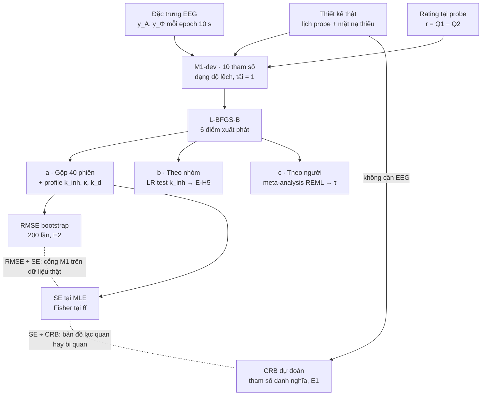

# Fit mô hình M1 trên EEG thật: ví dụ ds001787 cho bài model

> **Phiên bản 2.3 — 25/10/2026** (v2.2: 24/10, v2.1: 17/10). Thay cho v1.0 (trục mức-ý-thức với ANPHY/Chennu/ds003969), hoãn từ 03/10/2026 vì cần ~90 GB. Bản v1.0 còn trong lịch sử git; tóm tắt ở Phụ lục A.
>
> **Trạng thái 25/10/2026: XONG, E0–E3 đều PASS.** Đăng ký trước khoá 19/10/2026 13:48 UTC, file EEG đầu tiên tải 13:49 UTC. 22/40 phiên giữ lại theo quy tắc đã khoá. Kết quả: 1/k_inh = 0,76 phút (CI profile 0,49–1,17); SE Fisher của k_inh 9,9 % (dự đoán 9,1–13,3 %) nhưng SE profile/Hessian 22 % → kênh alpha sai đặc tả; E-H1 đạt (Fisher), E-H2 không đạt, E-H3 đạt về dấu, E-H4 không xác định, E-H5 không đạt; quy tắc 4/5 chỉ đạt với α. Đã viết vào bài: mục 4.7, Hình 9–10, Bảng 9–10, Phụ lục H (`template_latex/`, bản Anh và Việt). Số liệu: `outputs/paper/realdata/summary.json`; tóm tắt cho thầy: `outputs/paper/realdata/TOM_TAT_GUI_THAY.md`.
> **Vai trò:** mục "Application to an experience-sampling EEG dataset" của bài trong `Q1_pipeline_model.md`. Không phải bài riêng.
> **Dữ liệu:** chỉ ds001787, 6,1 GB, tải được trong một buổi.
>
> **Trạng thái 17/10/2026:** mã đã viết đủ cho mọi bước (`python main.py realdata …`, 9 test mới, 99 test toàn repo pass). **E0 PASS** (950/983 probe giải mã, giả thuyết "phím 0 không có trigger" xác nhận 0/741), **E1 PASS** (hạng 10/10 và 11/11 trên lịch probe thật; CRB(k_inh) dự đoán 9,1 % gộp, 12,4 % expert, 13,5 % novice; MDE hiệu log k_inh 0,51). `preregistration/predictions_realdata.md` đã soạn, **chưa khoá**. Chưa tải BDF (6,1 GB) — chờ khoá đăng ký. Ba sửa đổi so với v2.0 ghi ở §4 mục 6, §2 và `predictions_realdata.md` §4.

---

## Mục lục

1. Luận điểm và định vị
2. Dữ liệu ds001787
3. Câu hỏi và dự đoán đăng ký trước
4. Tiền xử lý
5. Đặc trưng EEG và rating
6. Fit mô hình (M1-dev)
7. Kiểm tra mô hình
8. Cổng kiểm tra và tiêu chí dừng
9. Cấu trúc mã và lệnh chạy
10. Lộ trình 8 tuần
11. Đưa vào bài model
12. Câu hỏi phản biện
13. Những chỗ hay hỏng
14. Quy tắc liêm chính
15. Checklist trước khi nộp
- Phụ lục A. Hướng trục mức-ý-thức (v1.0, hoãn)

---

## 1. Luận điểm và định vị

Phần này thêm vào bài model một ví dụ trên dữ liệu thật: fit M1 lên ds001787 và kiểm tra xem bản đồ thiết kế in silico có dự đoán đúng những gì dữ liệu thật cho phép ước lượng hay không.

**Câu hỏi trung tâm.** Với một bộ experience-sampling thật (24 người, ~45 phút/phiên, probe ~1,5 phút/lần, EEG 64 kênh), những tham số nào của M1 xác định được, với sai số bao nhiêu, và mô hình có dự đoán rating tốt hơn các mô hình rỗng không?

**Vì sao ds001787.**
- Thiết kế tham chiếu của bài (N = 12, 45 phút, probe mỗi 2 phút) vốn đã lấy theo bộ này.
- Chỉ 6,1 GB.
- Là bộ duy nhất trong kế hoạch có probe dày xen EEG liên tục, đúng cấu trúc quan sát (13)–(14) của M1.

**Đóng góp thêm cho bài.**
1. Kiểm chứng ngoài mô phỏng: CRB dự đoán so với SE tại MLE và RMSE bootstrap trên đúng lịch probe và khoảng trống thật.
2. Trả lời phản biện "có ai đo được không": ước lượng k_inh, k_d trên dữ liệu người, có CI.
3. Kiểm định ngoài mẫu: M1 so với mô hình chỉ rating và mô hình hồi quy tức thời.

**Không tuyên bố.** Không nói đặc trưng EEG "là" DMN hay Φ: chúng là proxy có nhiễu, và câu hỏi là mô hình quan sát có đứng được không. Không nói thiền "làm tăng" ý thức. Không so giá trị tuyệt đối của A, Φ với tham số danh nghĩa, vì đặc trưng thật không có đơn vị tự nhiên (mục 6).

---

## 2. Dữ liệu ds001787

Số liệu lấy trực tiếp từ metadata của https://github.com/OpenNeuroDatasets/ds001787 (clone 16/10/2026, phiên bản 1.1.1) và bài gốc Brandmeyer & Delorme (Exp. Brain Res. 236, 2519–2528; bản tác giả: https://sccn.ucsd.edu/~arno/mypapers/brandmeyer2016_author.pdf). Chưa tải file BDF nào.

| Mục | Giá trị | Ghi chú cho pipeline |
|---|---|---|
| Người | 24: sub-001–012 expert, sub-013–024 novice | Thiền mantra Himalayan Yoga, ghi tại Rishikesh |
| Phiên | 40 (1–3 phiên/người) | sub-022 có 3 phiên; 9 người chỉ 1 phiên |
| Độ dài phiên | 966–3629 s, trung vị 2718 s (45 phút) | Tổng 27,6 giờ: expert 15,0 h (22 phiên), novice 12,6 h (18 phiên) |
| Probe | 983, tức 9–42/phiên | Khoảng cách trung vị 72–134 s tuỳ phiên, cực trị 16–410 s |
| EEG | 64 kênh Biosemi ActiveTwo, nhãn 10-20 sẵn | Tham chiếu CMS/DRL, chưa lọc phần mềm |
| Lấy mẫu | 256 Hz (hạ từ 2048 Hz bằng decimator Biosemi) | |
| Điện lưới | 50 Hz | Notch 50 Hz |
| Kênh phụ | EXG1–8, GSR, Resp, Plet, Temp | Không có nhãn EOG; không dùng |
| Dung lượng | 6,1 GB, 40 file BDF (~120–170 MB/phiên 45 phút) | Vẫn tải theo subject cho gọn |

**Cấu trúc probe.** Mỗi probe gồm ba câu nối tiếp, thang 0–3: Q1 độ sâu thiền, Q2 độ sâu mind-wandering, Q3 độ buồn ngủ. Cả ba đánh giá khoảng ngay trước câu đầu tiên. Thiết kế gốc: probe cách nhau ngẫu nhiên 30–90 s; khoảng giữa hai lần bắt đầu probe đo được dài hơn vì cộng thời gian trả lời (~10 s).

**Vấn đề mã hoá phản hồi (phải giải trước khi fit).** `events.tsv` chỉ có ba mã phản hồi 2, 4, 8 (cộng 16 = phản hồi không chủ ý, 254 = mã lạ, 5 lần), trong khi thang có bốn mức. Số phản hồi mỗi probe: 0 ở 8 probe, 1 ở 171, 2 ở 440, 3 ở 364. Giả thuyết hợp lý nhất: phím 1/2/3 sinh mã 2/4/8, phím 0 không sinh trigger. Khi đó probe có hai phản hồi nghĩa là một câu được trả lời 0, nhưng không biết câu nào. Độ trễ phản hồi (~3 s, ~5,5 s, ~9 s sau mốc 128) giúp phân loại một phần. Nguồn giải quyết: `code/MW_Current_TextFileBIDS.zip` (360 KB, thêm ở bản 1.1.0) và `code/run_mw_experiment6.m`. Xem cổng E0.

**Kết quả E0 (17/10/2026, `python main.py realdata ratings`).** Script gốc `run_mw_experiment6.m` xác nhận cơ chế: phím k bật đường k+1 của cổng song song, nên phím 1/2/3 → mã 2/4/8 và phím 0 → mã 1, mã này không có trong events.tsv. Đối chiếu 42 file hành vi với 40 phiên EEG (gán file cho phiên bằng căn chỉnh thời điểm probe, vì hậu tố `_2` của tên file không phải chỉ số phiên: `sub14_info.txt` không khớp phiên duy nhất của sub-014, `sub14_2_info.txt` mới khớp 24/24): 950/983 probe khớp trong 0,5 s (96,6 %), Q1 và Q2 biết được ở 96,6 % probe, mã trigger khớp phím ở 99,4 %, và **0/741 lần bấm phím 0 có trigger**. Ngoại lệ: sub-013 ses-01 (file hành vi là một lần chạy khác, 3/25 khớp; chỉ 4 probe đủ 3 phản hồi giải mã được từ events) và sub-021 (33/37). Kết quả: `data/ds001787/derivatives/probes.csv`, `e0_summary.json` (bản sao trong `outputs/results/realdata/`).

**Cách tải.** Repo GitHub chỉ chứa metadata và symlink git-annex; nội dung nằm trên S3 của OpenNeuro. Repo này được clone vào `ds001787/` ở gốc dự án (không đưa vào git của dự án; `.gitignore`), còn file tải về nằm trong `data/ds001787/`. `eeg/fetch.py` tải thẳng từ S3 theo subject, kiểm MD5 theo khoá annex, và **từ chối tải BDF khi chưa có `predictions_realdata.lock`**.

```bash
# Cách 1: DataLad (khuyên dùng, kiểm checksum tự động)
datalad install https://github.com/OpenNeuroDatasets/ds001787.git
cd ds001787
datalad get code/ participants.tsv '*_events.tsv' '*_eeg.json'   # vài MB, làm E0 trước
datalad get sub-001                                              # rồi từng subject

# Cách 2: openneuro-py
openneuro-py download --dataset ds001787 --include code --include 'sub-001/*'
```

Ghi mọi file đã tải vào `data/manifest.csv` (subject, phiên, MD5 trong tên annex, kích thước, ngày tải).

---

## 3. Câu hỏi và dự đoán đăng ký trước

Khoá dự đoán **sau E0 và E1, trước khi tải bất kỳ file EEG nào**: `python main.py preregister --file predictions_realdata.md` ghi SHA-256 + timestamp vào `predictions.lock`; `fetch.py` từ chối tải BDF nếu chưa có lock hoặc file đã bị sửa. Khai báo trung thực trong bài: metadata và file hành vi đã được xem trước khi khoá; EEG thì chưa.

**Dự đoán định lượng rút từ bản đồ thiết kế.** ds001787 có 1656 phút-người, gấp ~3 lần mức 480–540 phút mà bài cần để CRB(k_inh) ≈ 15%. Ngoại suy theo Bảng 6 (CRB ∝ N^−0,50 T^−0,46), ở SNR danh nghĩa: gộp 40 phiên ≈ 9%; expert (22 phiên) ≈ 12%, novice (18) ≈ 13%; hiệu log k_inh phát hiện được nếu ≥ 0,50 đơn vị log.

**Tính lại chính xác ở E1 (17/10/2026, `python main.py realdata design-crb`)**, bằng Fisher chính xác trên đúng thời điểm probe trong `events.tsv` của 40 phiên, với 20,1 % epoch bị che quanh probe:

| | k_inh | κ | k_d | α | β | σ_A | σ_Φ | r_A | r_Φ | r_Q |
|---|---|---|---|---|---|---|---|---|---|---|
| Gộp 40 phiên | **9,1 %** | 11,1 % | 14,1 % | 2,0 % | 4,0 % | 3,0 % | 3,6 % | 1,1 % | 0,9 % | 2,7 % |
| Expert (22) | 12,4 % | | 19,1 % | 2,7 % | 5,3 % | | | | | |
| Novice (18) | 13,5 % | | 21,0 % | 3,0 % | 5,9 % | | | | | |

Hạng Rothenberg 10/10 (trị riêng tương đối nhỏ nhất 0,20) và 11/11 khi thêm r_AΦ. MDE của hiệu log k_inh expert − novice (lực 80 %, α = 0,05): 0,51 đơn vị log, tức hệ số 1,67. Ngoại suy từ bản đồ thiết kế đúng đến ±1 điểm phần trăm. Số liệu: `outputs/results/realdata/e1_design_crb.json`.

| Mã | Dự đoán | Nguồn | Phép thử | Ủng hộ khi |
|---|---|---|---|---|
| E-H1 | Nếu SNR đặc trưng DMN đạt mức danh nghĩa (sd∞(A)/r_A ≥ 1,58), sai số tương đối của k_inh gộp ≤ 20% | Bài model, mục 4.4 và 4.6 | SE từ Fisher tại MLE + bootstrap tham số | Điều kiện SNR đúng và SE ≤ 0,20; nếu SNR thấp hơn, so SE với CRB dự đoán tại SNR đã fit |
| E-H2 | M1 dự đoán rating ngoài mẫu tốt hơn mô hình rỗng | Lý do tồn tại của mô hình | LPD tại probe, leave-one-session-out | ΔLPD > 0, CI 95% bootstrap theo phiên loại 0, với cả hai mô hình rỗng (mục 7) |
| E-H3 | Proxy tích hợp liên hệ dương với rating: α > 0 | v1.0 H1 (phức tạp thiền > MW) | CI 95% của α | CI nằm trên 0 |
| E-H4 | Dấu của β (hai phía) | BQI: alpha sau là proxy DMN nên β > 0. Brandmeyer: alpha tăng khi thiền nên β < 0 | CI 95% của β | Báo dấu; β < 0 nghĩa là alpha sau không đóng vai DMN trong mô hình |
| E-H5 | k_inh expert > novice | v1.0 mục 7.2 | Hiệu log k_inh, fit theo nhóm | Hiệu > 0, CI loại 0; nếu CI chứa 0 thì báo kèm MDE |

**Câu hỏi ước lượng (không có giả thuyết).** Hằng số thời gian 1/k_inh gần 5 phút (danh nghĩa của bài) hay 23 phút (giá trị in trong [40])? Báo CI và đối chiếu với Limitations của bài.

**Khám phá, báo riêng.** Q3 như covariate của rating; xu hướng theo thời gian trong phiên; khác biệt giữa các phiên của cùng người.

---

## 4. Tiền xử lý

Khác biệt cốt lõi so với bài gốc: Brandmeyer chỉ lấy một epoch 10 s trước mỗi probe; M1 cần chuỗi epoch 10 s **liên tục suốt phiên**, vì y_A, y_Φ là kênh dày. Epoch xấu **không bị xoá mà đánh dấu thiếu**; bộ lọc Kalman bỏ qua bước cập nhật ở đó (Phụ lục D của bài đã hỗ trợ).

Tham số trong `eeg/config.yaml`:

1. Đọc BDF bằng `mne.io.read_raw_bdf`, montage `biosemi64`, bỏ EXG/GSR/Resp/Plet/Temp.
2. Lọc 1–40 Hz (FIR zero-phase), notch 50 Hz. Giữ 256 Hz.
3. Tham chiếu trung bình. Kênh xấu bằng RANSAC (`pyprep`) hoặc z-score; nội suy spline. Ghi số kênh nội suy mỗi phiên (bài gốc: 0–20, trung bình 6).
4. ICA: Picard (extended infomax) khớp trên bản sao lọc 1–100 Hz của cùng dữ liệu đã làm sạch (dải huấn luyện của ICLabel; header Biosemi đã giới hạn ở 52 Hz), rồi áp ma trận tách lên dữ liệu 1–40 Hz; nhãn ICLabel, loại mắt/cơ có xác suất ≥ 0,8.
5. Che khoảng probe: từ mốc 128 đến phản hồi cuối của probe + 3 s; probe không có phản hồi che 15 s.
6. **Lưới epoch đều từ đầu bản ghi, rating tại đúng mốc 128** (sửa đổi v2.1, thay cho lưới neo theo probe của v2.0): epoch kết thúc tại t_k = 10k s. Rating là một quan sát của QoC tại **đúng thời điểm** mốc 128; bộ lọc Kalman và Fisher chính xác hỗ trợ bước thời gian thay đổi (`eeg/model_fit.kalman_filter_irregular`, `model/fisher.IrregularDesign`), nên không cần dịch hay xoá epoch để gán rating. Lý do đổi: lưới neo theo probe tạo khoảng cách không đều giữa đoạn này và đoạn sau (vi phạm Δ = 10 s mà v2.0 muốn giữ), còn cách này giữ Δ = 10 s cho EEG và đặt rating đúng chỗ người tập đánh giá.
7. Epoch biên độ > 150 µV hoặc có điểm bị che ở bước 5 → thiếu. Ghi tỉ lệ thiếu mỗi phiên.
8. Mỗi bước ghi log vào `derivatives/ds001787/<sub>/<ses>/prep_log.json`.

**Tiêu chí giữ phiên** (khoá cùng dự đoán): bỏ phiên có > 40% epoch thiếu hoặc < 8 probe có rating giải mã được. Báo số phiên bị bỏ theo nhóm.

**Sửa đổi sau đăng ký v2.2 (24/10/2026), quyết định trước khi xem bất kỳ đặc trưng nào cùng rating.** Khảo sát biên độ trên cả 40 phiên (chỉ lọc + tham chiếu, không ICA, không đặc trưng; `outputs/results/realdata/artifact_survey.csv`) cho thấy quy tắc đã khoá (đỉnh-đỉnh > 150 µV ở *bất kỳ* kênh nào trong 64 kênh) làm thiếu trung vị 38 % epoch và **chỉ giữ 22/40 phiên** (12 expert, 10 novice). 18 phiên bị bỏ (45 %) vẫn dưới ngưỡng dừng K3 (50 %), nên **phân tích chính giữ nguyên quy tắc đã khoá**. Nguyên nhân: nhiễu cơ ở kênh thái dương (T7, TP8, FT7, FT8, P10; trung vị đỉnh-đỉnh 100–150 µV ở sub-001 ses-02) và một số phiên có biên độ nền cao toàn bộ (sub-003, sub-018, sub-022: trung vị 85–140 µV so với 35–55 µV ở phiên khác), nghĩa là việc loại phiên không ngẫu nhiên. ICLabel không giảm tỉ lệ này (thử trên 2 phiên: 63 % và 66 % trước và sau). Vì vậy thêm **một phân tích nhạy ngoài đăng ký**, báo riêng và không tính vào quy tắc 4/5: epoch bị loại khi đỉnh-đỉnh lớn nhất trên các kênh dùng cho đặc trưng vượt max(150 µV, trung vị phiên + 5 MAD); với quy tắc này trung vị thiếu 22 % và giữ đủ 40/40 phiên. Đặc trưng nay được tính cho mọi epoch ngoài cửa sổ probe (file đặc trưng định dạng 2 lưu `mask` đã khoá, `mask_probe`, `mask_adaptive`), nên cả hai quy tắc dùng chung một lần chạy `preprocess`. Đồng thời ghi nhận nhiễu do giới và tuổi giữa hai nhóm (expert 10/12 nam, tuổi TB 39; novice 2/12 nam, tuổi TB 48): E-H5 sẽ được báo kèm phân tích khám phá có hiệp biến tuổi và giới.

**Đầu ra.** Mỗi phiên một `epochs.parquet`: chỉ số epoch, thời điểm, cờ thiếu, và dữ liệu sạch 64 × 2560 mẫu mỗi epoch.

---

## 5. Đặc trưng EEG và rating

Chốt **một cặp đặc trưng chính và đúng ba phương án thay thế** trước khi thấy dữ liệu. Mọi phương án khác là khám phá.

| Kênh mô hình | Chính | Thay thế (phân tích nhạy) | Cách tính |
|---|---|---|---|
| y_A (proxy DMN) | log công suất alpha 8–12 Hz vùng sau: Pz, POz, P3, P4, PO3, PO4, O1, O2, Oz | (i) alpha tuần hoàn từ specparam; (ii) log theta 4–7 Hz đường giữa trán: AFz, Fz, FCz, Cz | Welch, cửa sổ 2 s chồng 50% trong epoch 10 s, trung bình kênh |
| y_Φ (proxy tích hợp) | LZc khử phổ trên 19 kênh 10-20 chung | (iii) exponent aperiodic specparam 1–40 Hz, đổi dấu | `eeg/metrics/lzc.py` + `surrogate.py`, 20 surrogate phase-randomized đa kênh mỗi epoch |
| rating (QoC) | r = Q1 − Q2, thang −3…3 | Q1 riêng (0–3) | Gán cho epoch kết thúc tại mốc 128 của probe |

**Khử phổ** (giữ từ v1.0): mỗi chỉ số phức tạp X được tính trên dữ liệu thật và trên surrogate phase-randomized (giữ phổ từng kênh và cross-spectrum):

```
X_spec-indep = (X_real − mean(X_surr)) / sd(X_surr)
```

**Vì sao r = Q1 − Q2.** Brandmeyer cho thấy hiệu hai câu khử phần lớn thiên lệch chấm điểm của từng người. Thang 7 mức cũng đỡ vi phạm giả định Gauss của (14) hơn thang 4 mức. Q3 không vào rating.

**Vì sao 20 surrogate thay vì 50.** Cả bộ ~11.000 epoch; 20 surrogate giữ chi phí vài giờ trên laptop. Kiểm trên 5 phiên ngẫu nhiên (seed cố định) rằng tương quan giữa bản 20 và 50 surrogate > 0,95; nếu không, dùng 50.

**Đơn vị và chuẩn hoá** (mô hình viết ở dạng độ lệch, mục 6):
1. Trừ trung bình theo phiên cho y_A, y_Φ và rating.
2. Chia y_A, y_Φ cho độ lệch chuẩn gộp trong-phiên của toàn bộ dữ liệu (một hằng số mỗi đặc trưng), để SNR khác nhau giữa các phiên vẫn được giữ.
3. Phân tích nhạy: z-score theo từng phiên.

**QC trước khi fit (không phải kiểm định).** Tự tương quan của y_A, y_Φ theo trễ 1–30 epoch. OU có thời gian 5 phút cho ~0,97 ở trễ 1 trên biến ẩn, ~0,7 trên quan sát khi cộng nhiễu danh nghĩa. Trung vị < 0,3 ở trễ 1 → không có động lực để fit, dừng theo K2.

---

## 6. Fit mô hình (M1-dev)

Trên dữ liệu thật, M1 được fit ở **dạng độ lệch**. Khi đặc trưng không có đơn vị tự nhiên và trung bình đã bị trừ theo phiên, các mức A0, Φ\*, γ0 không còn xác định được. Đây là hệ quả cùng loại với đối xứng affine ở Phụ lục B của bài, không phải lỗi pipeline.

```
dx̃ = M x̃ dt + G dW,      M = [[−k_inh, 0], [−κ, −k_d]],   κ = k_int / A_max
y_A = Ã + η_A,   y_Φ = Φ̃ + η_Φ,   r = α Φ̃ − β Ã + ε     (tại epoch probe)
```

θ_dev = (k_inh, κ, k_d, σ_A, σ_Φ, α, β, r_A, r_Φ, r_Q): 10 tham số. Hệ số tải cố định bằng 1 sau chuẩn hoá ở mục 5, nên không còn đối xứng co giãn (tương tự cấu hình (d)). κ, α, β ước lượng trên thang tuyến tính, dấu tự do (E-H4); các tham số dương còn lại trên thang log như bài.

**Hệ quả ghi rõ trong bài.** A0, một trong bốn tham số chính của bản đồ thiết kế, không ước lượng được nếu không có đặc trưng DMN đã hiệu chuẩn. Đại lượng diễn giải được: hai tốc độ k_inh, k_d (phút⁻¹, không phụ thuộc thang đặc trưng) và dấu/độ lớn tương đối của α, β, κ.



**Thay đổi mã.**
1. `bqi/dmn_ode.py`: `StateSpaceDMN(deviation=True)`, bỏ u và γ0, tham số hoá theo κ.
2. `model/fisher.py`: `Design` nhận `probe_idx` thật và mặt nạ thiếu cho từng kênh; Fisher chính xác chỉ việc bỏ các hàng tương ứng của S (Phụ lục E).
3. `eeg/model_fit.py`: log-likelihood là tổng qua các phiên có độ dài và mặt nạ khác nhau; mỗi phiên bắt đầu từ N(0, P).

**Quy trình fit.**
1. Sáu điểm xuất phát, giữ cực trị tốt nhất: tham số danh nghĩa quy về dạng độ lệch; ước lượng mô-men (k_inh từ tự tương quan trễ 1 của y_A, k_d từ y_Φ, α, β từ hồi quy rating lên y tại epoch probe); bốn điểm nhiễu quanh hai điểm đầu (seed 42).
2. L-BFGS-B như Mục 3.2 của bài.
3. Ba mức gộp: (a) gộp 40 phiên, một θ chung (giả định của bài); (b) theo nhóm, kiểm định tỉ số hợp lý k_inh riêng so với chung (1 bậc tự do) cho E-H5; (c) theo từng người, rồi meta-analysis hiệu ứng ngẫu nhiên (REML) trên log k_inh với SE từ Fisher, ước lượng độ dị biệt τ.

**Ba con số sai số đặt cạnh nhau** cho k_inh, k_d, α, β:

| Con số | Tính thế nào | Có khi nào |
|---|---|---|
| CRB dự đoán | Fisher chính xác tại tham số danh nghĩa, trên lịch probe và mặt nạ thật | Trước khi tải EEG (E1, khoá cùng dự đoán) |
| SE tại MLE | Fisher kỳ vọng chính xác tại θ̂, đối chiếu Hessian số | Sau fit |
| RMSE bootstrap | 200 bộ mô phỏng từ θ̂ trên đúng thiết kế thật, mỗi bộ fit lại | Sau fit (E2) |

SE ÷ CRB cho biết bản đồ thiết kế lạc quan hay bi quan so với SNR thật. RMSE ÷ SE là bản lặp của cổng M1 trên thiết kế thật. Thêm profile likelihood cho k_inh, κ, k_d, 9 điểm trong ±0,8 log như Hình 3 của bài.

---

## 7. Kiểm tra mô hình

Ba lớp kiểm tra quyết định tham số có được diễn giải như tốc độ động lực hay không (E3).

**Phần dư** (innovation chuẩn hoá của Kalman tại θ̂, theo phiên):
- Độ trắng: Ljung–Box trễ 1–30 epoch cho y_A, y_Φ; tự tương quan theo probe cho rating.
- Phân phối: QQ-plot, độ lệch, độ nhọn.
- Tương quan chéo trễ 0 giữa innovation y_A và y_Φ. Cả hai lấy từ cùng epoch nên nhiễu quan sát có thể tương quan, trái với R chéo của (13). Nếu |ρ| > 0,2, phân tích chính dùng R đầy đủ (thêm r_AΦ); E1 đã kiểm tham số này xác định được.

**Dự đoán ngoài mẫu (E-H2).** Leave-one-session-out: fit θ trên 39 phiên, lọc phiên còn lại, dự đoán rating tại từng probe.

| Chế độ | Thông tin dùng để dự đoán rating tại probe k | M1 phải thắng |
|---|---|---|
| (a) chỉ EEG | y_A, y_Φ đến hết epoch probe k, không dùng rating | N2: hồi quy tức thời r = c + b_A·y_A + b_Φ·y_Φ tại epoch probe |
| (b) EEG + rating quá khứ | như (a), cộng rating đến probe k−1 | N1: M1 chỉ có kênh rating (cấu hình (a) của bài) và N3: trung bình phiên |

Thước đo chính: log predictive density Gauss. Phụ: MAE, Spearman với r thứ bậc. CI 95% bootstrap theo phiên (2000 lần). N2 là đối thủ quan trọng nhất: nếu M1 không thắng N2 ở chế độ (a), phần động lực không đóng góp gì cho việc đọc trạng thái từ EEG.

**Dự đoán hậu nghiệm cho rating thứ bậc.** Mô phỏng rating từ θ̂ trên đúng lịch probe, làm tròn và cắt về −3…3; so phân phối các mức, tự tương quan giữa probe liên tiếp, và hiệu expert − novice với dữ liệu. Lệch lớn ở mức biên → ghi vào Limitations, đề xuất mô hình đọc ra thứ bậc.

**Phân tích nhạy (khoá trước, báo tất cả).**
1. Ba phương án đặc trưng thay thế (mục 5), mỗi lần thay một kênh.
2. Z-score theo phiên.
3. R đầy đủ.
4. Chỉ phiên có ≤ 20% epoch thiếu.
5. Chỉ 20 probe đầu mỗi phiên.

Kết luận chính chỉ phát biểu nếu dấu α, β và khoảng 1/k_inh không đổi qua ít nhất 4/5 phân tích nhạy.

---

## 8. Cổng kiểm tra và tiêu chí dừng

Bốn cổng E0–E3 (không trùng G0–G3 của v1.0), ghi vào `eeg/gates.py` theo cơ chế M0–M2 (`outputs/gates/E*.json`, timestamp UTC). Lần này các bước **gọi `gates.require` thật**: E1 ← E0, E2 ← E1, E3 ← E2; ghi đè chỉ bằng `--force-gate` và được log.

| Cổng | PASS khi | Lệnh | Nếu FAIL |
|---|---|---|---|
| **E0** giải mã rating | File hành vi khớp `events.tsv` ở ≥ 95% probe (lệch < 0,5 s), xác nhận hoặc bác giả thuyết "phím 0 không có trigger"; Q1, Q2 biết được ở ≥ 90% probe | `eeg ratings` | Dự phòng: phân loại theo độ trễ, học trên probe đủ 3 phản hồi, kiểm chéo. Độ chính xác < 90% → K1 |
| **E1** xác định cấu trúc trên thiết kế thật | Rothenberg cho M1-dev trên lịch probe thật: hạng 10/10 (và 11/11 khi thêm r_AΦ), trị riêng tương đối nhỏ nhất > 1e−7; CRB dự đoán đã tính. Việc khoá `predictions_realdata.md` được cưỡng chế ở bước tải (fetch từ chối BDF khi chưa có lock) | `realdata design-crb` rồi `realdata preregister --yes` | Tham số hoá lại trước khi tải EEG; ghi nhật ký sai lệch |
| **E2** xác định thực hành | Ở ≥ 3/4 tham số chính (k_inh, k_d, α, β): RMSE bootstrap / SE ∈ [0,5; 2]; profile k_inh, κ, k_d đơn mốt trong ±0,8 log | `realdata boot` | Chạy lại 12 điểm xuất phát. Vẫn FAIL: đây là kết quả (không xác định được trên dữ liệu thật), báo kèm SNR đo được |
| **E3** đủ tốt để diễn giải | Trung vị p Ljung–Box (y_A, y_Φ, trễ 1–30) > 0,01; đã chạy E-H2 và 5 phân tích nhạy | `realdata check` | Không diễn giải tham số như tốc độ; báo sai đặc tả |

Trạng thái 17/10/2026: **E0 PASS, E1 PASS** (`outputs/gates/E0.json`, `E1.json`); E2, E3 chờ dữ liệu EEG.

**Tiêu chí dừng.**
- **K1** rating không giải mã được: bỏ kênh rating, vẫn fit động lực hai kênh EEG cho k_inh, k_d, κ; mất E-H2 đến E-H4.
- **K2** đặc trưng gần nhiễu trắng (trung vị tự tương quan trễ 1 < 0,3 cho y_A chính): dừng fit; báo SNR đo được, đối chiếu bản đồ thiết kế.
- **K3** > 50% phiên bị loại theo mục 4: dừng.
- **K4** sau 6 tuần chưa qua E2: nộp bài model như hiện tại, giữ phần dữ liệu thật cho bài sau.

Mọi kết cục, kể cả K1–K3, đều được báo cáo trong bài.

---

## 9. Cấu trúc mã và lệnh chạy

Tái dùng `model/fisher.py`, `eeg/model_fit.py`, `eeg/metrics/`, `eeg/surrogate.py`, `eeg/preprocess.py` (kênh xấu, ánh xạ 19 kênh), `eeg/gates.py`. Thông số mới trong `model/config.py` (khối `REALDATA`). Trạng thái mã 17/10/2026: **đã viết và test** (9 test trong `tests/test_realdata.py`, trong đó một test chạy đủ fit → boot → check trên phiên mô phỏng theo lịch probe thật).

```
bqi_project/
  ds001787/                 # clone metadata OpenNeuro (events, json, annex pointers) — không vào git dự án
  data/ds001787/            # code/ (file hành vi, đã tải), BDF (chưa tải), derivatives/{probes.csv, features/*.npz}
  bqi/dmn_ode.py            # ĐÃ SỬA: DeviationDMN (dạng độ lệch, κ tuyến tính dấu tự do, rho_obs tuỳ chọn)
  model/
    config.py               # ĐÃ SỬA: khối REALDATA (đặc trưng, ngưỡng QC, bootstrap, cổng)
    fisher.py               # ĐÃ SỬA: IrregularDesign (thời điểm bất kỳ, mặt nạ theo kênh, r_AΦ), Fisher dạng đóng e^{Mτ}
    realdata.py             # MỚI: E1 design_crb; fit gộp/nhóm/người + REML; SE tại MLE; bootstrap (E2);
                            #      profile; phần dư Ljung–Box; LOSO với N1–N3; 5 phân tích nhạy (E3)
  eeg/
    loaders/ds001787.py     # MỚI: phiên, events, file hành vi, căn chỉnh thời gian, giải mã Q1–Q3, gate_E0, thiết kế thật
    fetch.py                # MỚI: tải S3 theo subject, MD5 theo khoá annex, manifest; từ chối BDF khi chưa có lock
    realdata_features.py    # MỚI: BDF → lọc/notch/kênh xấu/ICA → lưới 10 s + mặt nạ → 5 đặc trưng → npz
    model_fit.py            # ĐÃ SỬA: kalman_filter_irregular (bước thời gian thay đổi, mặt nạ, r_AΦ), fit(loglik=, starts=)
    gates.py                # ĐÃ SỬA: E0–E3, lock riêng cho predictions_realdata.md
  tests/test_realdata.py    # MỚI
  preregistration/predictions_realdata.md   # ĐÃ SOẠN, chưa khoá
  experiments/run_realdata.py   # ĐÃ VIẾT: Hình 9–10, bảng, summary.json → outputs/paper/realdata (`realdata paper`)
```

**Test bắt buộc trước khi chạy dữ liệu thật** (đã có trong `tests/test_realdata.py`):
1. Phục hồi tham số M1-dev trên dữ liệu mô phỏng theo lịch probe và mặt nạ không đều ✅
2. Kalman bước thay đổi = Kalman bước cố định trên lưới đều; = log-mật độ Gauss xếp chồng khi có mặt nạ và r_AΦ ≠ 0 ✅
3. Mặt nạ che đúng các epoch chồng lên cửa sổ probe ✅ (thay cho "epoch cuối kết thúc tại mốc 128" của v2.0)
4. Giải mã rating trên file events + hành vi tự tạo có probe 1, 2, 3 phản hồi và mã 254 ✅
5. Surrogate đa kênh giữ phổ (test cũ của `eeg/surrogate.py`) ✅

**Lệnh chạy theo thứ tự cổng.**

```bash
git clone https://github.com/OpenNeuroDatasets/ds001787.git     # metadata, 1 MB (đã làm)
python main.py realdata ratings                 # E0: tải code/ (360 KB) + giải mã           ✅ PASS
python main.py realdata design-crb              # E1: Rothenberg + CRB trên lịch thật        ✅ PASS
python main.py realdata preregister --yes       # khoá predictions_realdata.md (không đảo ngược)
python main.py realdata fetch --dry-run         # liệt kê 40 file, 6,11 GB
python main.py realdata fetch                   # tải BDF, kiểm MD5 (hoặc --subjects sub-001 ...)
set OMP_NUM_THREADS=1 && set MKL_NUM_THREADS=1
python main.py realdata preprocess              # tiền xử lý + đặc trưng → data/ds001787/derivatives/features
python main.py realdata fit   --seed 42         # fit gộp/nhóm/người, SE, profile
python main.py realdata boot  --seed 42         # E2 (200 lần)
python main.py realdata check --seed 42         # phần dư, LOSO, 5 phân tích nhạy → E3
python main.py realdata paper --seed 42         # Hình 9–10, bảng, summary.json (CRB tại SNR đo, Hessian, PPC)
python main.py gates
# (realdata groups: làm lại riêng phần E-H5 trên fit_results.json đã có, không fit lại)
```

Phụ thuộc: `mne` (đã cài, 1.13); tuỳ chọn `python-picard` (ICA nhanh hơn fastica), `mne-icalabel` (nhãn thành phần; nếu không có thì heuristic, ghi vào log). Không cần datalad/openneuro-py (tải thẳng S3). Thời gian ước tính: đặc trưng ~8 s/epoch với 20 surrogate LZc (đo trên epoch mô phỏng), ~11.000 epoch → 8–10 giờ với 3 tiến trình; bootstrap 200 lần × fit 40 phiên là bước nặng thứ hai.

---

## 10. Lộ trình 8 tuần

K4 cắt ở cuối tuần 6 nếu chưa qua E2.

| Tuần | Việc | Đầu ra kiểm tra được |
|---|---|---|
| 1 | Tải metadata + `code/`; E0; sửa `Design`/`fisher.py`; E1; viết và khoá `predictions_realdata.md` | **E0, E1**; `predictions.lock` trước log tải BDF |
| 2 | Tải 6,1 GB; tiền xử lý + ICA 40 phiên | Báo cáo QC: kênh nội suy, tỉ lệ thiếu, phiên bị loại |
| 3 | Đặc trưng; QC tự tương quan; 20 so với 50 surrogate | K2 không kích hoạt |
| 4 | Fit gộp, theo nhóm, theo người; profile | Bảng θ̂ |
| 5 | Bootstrap 200 lần; meta-analysis log k_inh | **E2** |
| 6 | LOSO với N1–N3, phần dư, 5 phân tích nhạy | **E3** |
| 7–8 | Viết mục mới, sửa abstract/discussion/limitations; chạy lại toàn bộ theo thứ tự cổng | Timestamp cổng tăng dần; số liệu khớp 100% |

---

## 11. Đưa vào bài model

- Mục mới 4.7 *Application to an experience-sampling EEG dataset*, 2–3 trang.
- Hình 9: một phiên ví dụ (y_A, y_Φ, trạng thái lọc ± 2 SD, rating quan sát và dự đoán). Hình 10: profile k_inh, k_d trên dữ liệu thật, đặt cạnh Hình 3.
- Bảng 10: ba con số sai số cho từng tham số chính. Bảng 11: LOSO, M1 so với N1–N3.
- Abstract thêm một câu về kết quả trên dữ liệu thật, dù theo nhánh nào.
- Limitations: bỏ "No real data are fitted", thay bằng "một bộ dữ liệu, proxy chưa hiệu chuẩn, A0 không ước lượng được".
- Data availability: thêm ds001787 (CC0), DOI 10.18112/openneuro.ds001787.v1.1.1.

**Tuyên bố nên dùng**: "Trên ds001787 (40 phiên, 983 probe), k_inh ước lượng với sai số tương đối X% (CRB dự đoán Y%); M1 dự đoán rating ngoài mẫu tốt hơn / không tốt hơn hồi quy tức thời."
**Tránh**: "alpha đo DMN"; "LZc đo Φ"; giá trị A0 hay mức Φ\* trên dữ liệu thật; mọi câu dạng "thiền làm tăng ý thức".

---

## 12. Câu hỏi phản biện

| Câu hỏi | Trả lời chuẩn bị sẵn |
|---|---|
| Alpha sau không phải DMN | Đồng ý; bài không tuyên bố vậy. Dấu β ước lượng hai phía (E-H4), có proxy thay thế; câu hỏi là mô hình quan sát có đứng được không |
| Rating thứ bậc 0–3, sao dùng Gauss | Dùng Q1 − Q2 (7 mức), kèm kiểm tra dự đoán hậu nghiệm; mô hình thứ bậc là hướng tiếp |
| Chọn đặc trưng theo kết quả | Một cặp chính + ba thay thế, khoá trước khi tải EEG (SHA-256) |
| Mỗi người khác nhau | Fit theo người + meta-analysis cho τ; fit gộp là giả định của bài, được kiểm tra trực tiếp |
| Fit được không có nghĩa là đúng | LOSO với mô hình rỗng tức thời N2, phần dư, cổng E3 chặn diễn giải khi sai đặc tả |
| Vì sao chỉ một bộ dữ liệu | Ví dụ kiểm chứng cho bài phương pháp; không ước lượng tham số dân số |
| LZc chỉ phản ánh phổ | Dùng LZc khử phổ bằng surrogate; exponent là phương án thay thế được khoá trước |

---

## 13. Những chỗ hay hỏng

1. **Fit trước khi qua E0** → rating sai câu (phím 0 không có trigger), mọi tham số α, β vô nghĩa.
2. **Xoá epoch xấu thay vì đánh dấu thiếu** → bước thời gian Δ không còn 10 s, ma trận F sai.
3. **Gán rating vào một epoch của lưới đều** → cửa sổ lệch tới 10 s so với lúc người tập đánh giá; phải đưa rating vào bộ lọc như quan sát tại đúng mốc 128 (v2.1 đã làm vậy).
4. **Quên rằng A0 không xác định được ở dạng độ lệch** → báo A0 hay Φ\* trên dữ liệu thật.
5. **Đổi đặc trưng sau khi xem kết quả** → chỉ được dùng một cặp chính + ba thay thế đã khoá.
6. **Tải BDF trước khi khoá dự đoán** → `fetch.py` phải chặn; kiểm tra log tải.
7. **Diễn giải k_inh khi E2 hoặc E3 FAIL** → báo như kết quả âm, không như tốc độ.
8. **Z-score theo phiên làm phân tích chính** → xoá khác biệt SNR thật giữa phiên; chỉ dùng làm phân tích nhạy.
9. **Trích bảng số liệu của bài BQI** → xem mục 14.

---

## 14. Quy tắc liêm chính

- Giữ mọi quy tắc của mục 15 trong `Q1_pipeline_model.md`: không dùng Table 4, 5, 6, 7, 11, 14, eq. 50, 59 của bài BQI và con số "47 nghiên cứu, N = 12.847" làm dữ liệu hay bằng chứng. Bài BQI chỉ là nguồn giả thuyết ("mô hình dự đoán X").
- Khai báo rằng metadata và file hành vi đã được xem trước khi khoá dự đoán; EEG thì không.
- Báo cáo mọi phân tích đã khoá, kể cả khi không ủng hộ dự đoán hoặc rơi vào K1–K3.
- Trích ds001787 theo `dataset_description.json` (Delorme & Brandmeyer, CC0, DOI 10.18112/openneuro.ds001787.v1.1.1) và bài gốc Brandmeyer & Delorme, Exp. Brain Res. 236, 2519–2528.

---

## 15. Checklist trước khi nộp

- [x] E0 PASS (17/10/2026; sub-013 ghi là ngoại lệ)
- [x] `predictions_realdata.lock` có trước log tải BDF (khoá 13:48:07 UTC, BDF đầu tiên 13:49:46 UTC ngày 19/10/2026); hash khớp `predictions_realdata.md`
- [x] E1 ✅, E2 ✅, E3 ✅ ghi rõ kết quả trong bài (mục 4.7), timestamp tăng dần
- [x] Ba con số sai số (CRB dự đoán, SE tại MLE, RMSE bootstrap) cho k_inh, k_d, α, β (Bảng 9, kèm CRB tại SNR đo và SE theo thông tin quan sát)
- [x] LOSO M1 so với N1–N3, CI bootstrap theo phiên (Bảng 10)
- [x] Phân tích nhạy báo đủ (6 biến thể đã khoá + 1 biến thể sau đăng ký, Bảng 12)
- [x] Không báo A0, Φ\* trên dữ liệu thật; không gọi alpha là DMN hay LZc là Φ
- [x] Tham số tiền xử lý và đặc trưng công bố trong `model/config.py` (khối REALDATA) và Phụ lục H
- [x] Data availability có ds001787 và DOI
- [x] Không còn số liệu nào từ các bảng BQI

---

## Phụ lục A. Hướng trục mức-ý-thức (v1.0, hoãn)

Kế hoạch v1.0 dựng trục mức-ý-thức từ tương phản ngủ (ANPHY-Sleep, 82,5 GB) và gây mê (Chennu), rồi chiếu Δ(thiền − MW) của ds003969 lên trục, với ds001787 làm bộ lặp lại. Năm giả thuyết H1–H5 (LZc khử phổ, chiếu trục, Kuramoto theta, exponent aperiodic, Fiedler λ₂) và cổng G0–G3 vẫn còn trong lịch sử git và trong khai báo của `eeg/gates.py`.

Hoãn vì dung lượng ANPHY. Nếu nối lại, các bộ thay thế nhẹ hơn cho trục giấc ngủ: MASS-SS3 (20 kênh 10-20, cần phê duyệt đạo đức), DOD-H (12 đạo trình lưỡng cực, mở), nap 64 kênh của Mei et al. 2018 (ít N3/REM). Những gì v2.0 tái dùng từ v1.0: khử phổ bằng surrogate (mục 5), cơ chế đăng ký trước, cơ chế cổng, loader và tiền xử lý.
